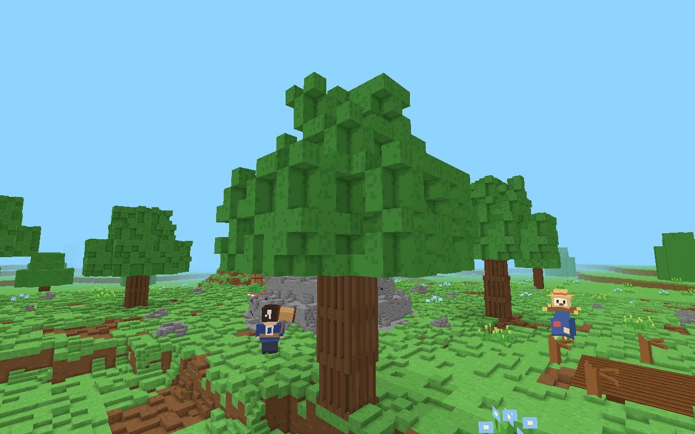
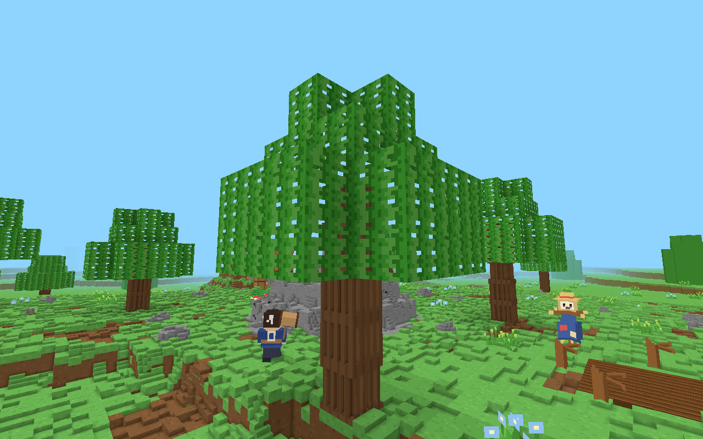
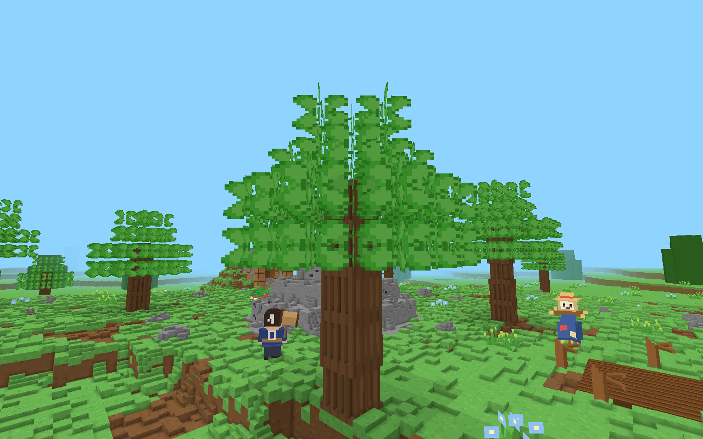
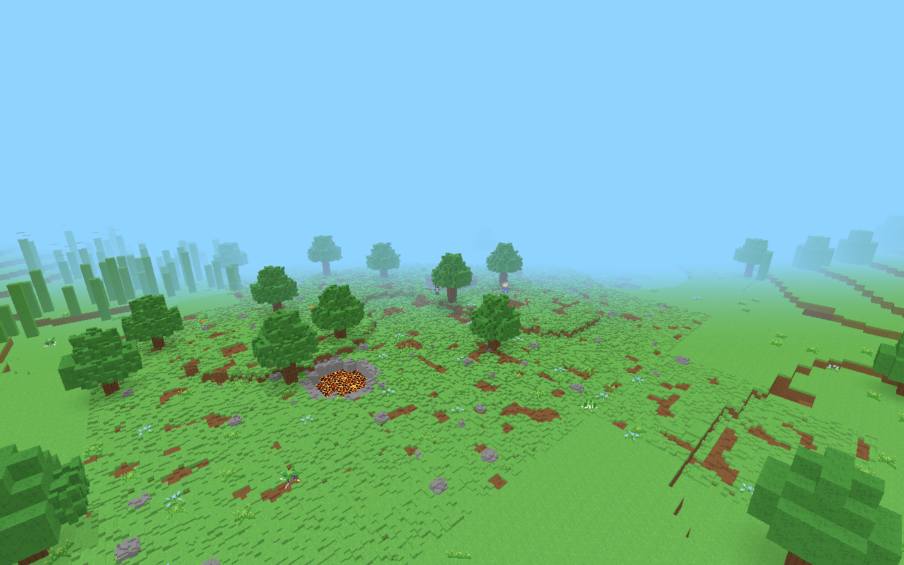
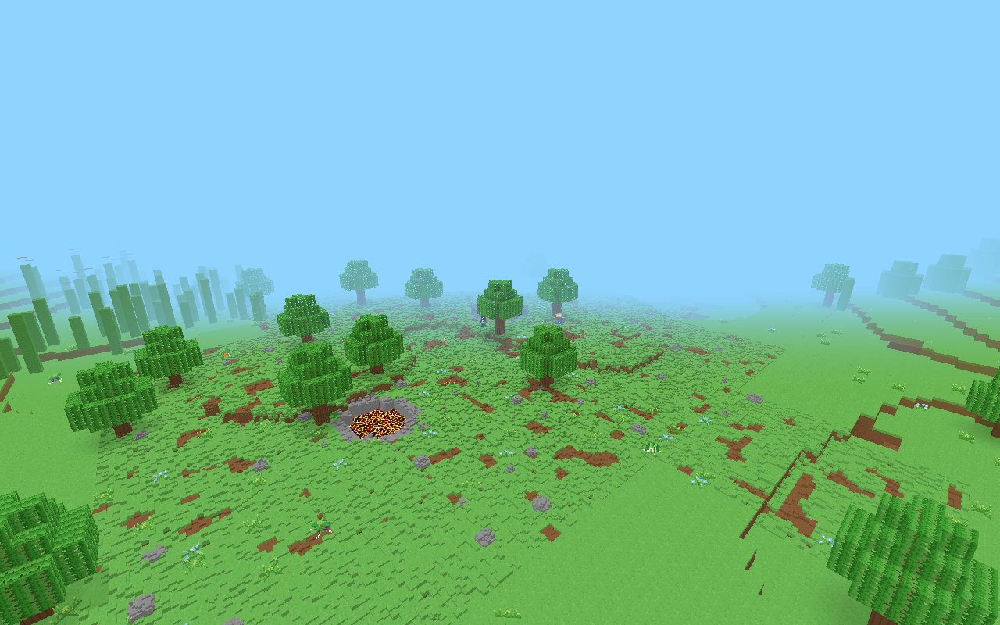
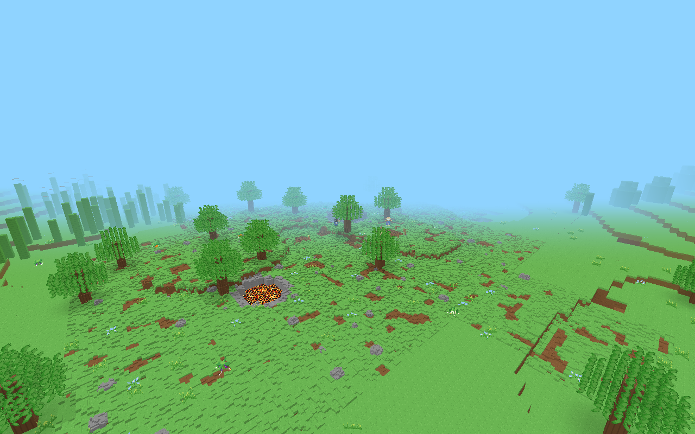
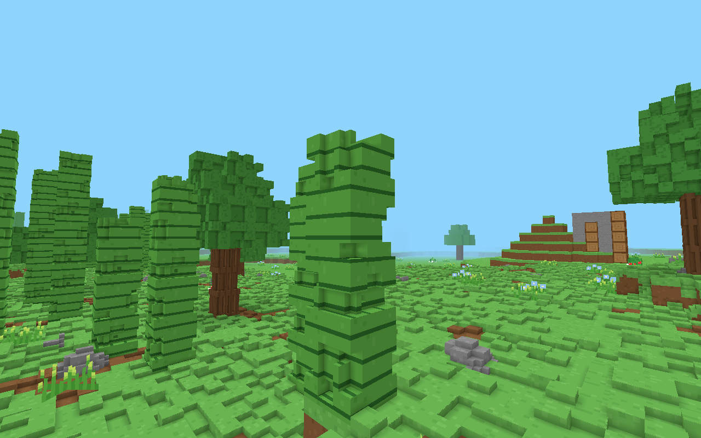
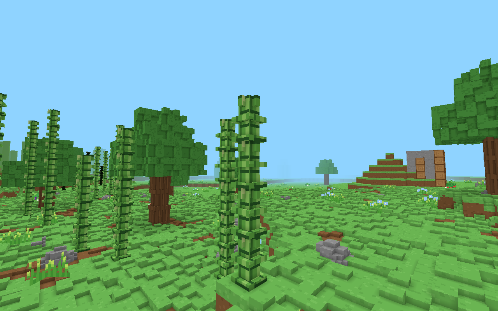
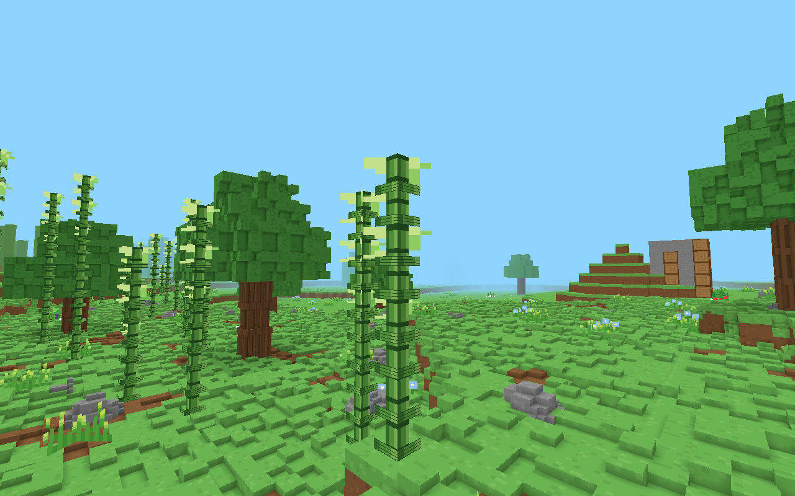

# はっぱと たけの 見た目（試し。まだ 決めない）

この ブランチは **下書き**です。ゲームの いつもの 見た目は、URL を 付けない かぎり 変わりません。マージは しません。写真を 見て、オーナーが 選びます。

遊びながら 見るとき（この ブランチ）:

- はっぱを 殻に: `?leaf=shell`
- はっぱを 十字の 板に: `?leaf=cross`
- たけを 細い 小ブロックに: `?bamboo=voxel`
- たけを 細い 板に: `?bamboo=sprite`

いつもの 島は シード `20261012`。例: `?menu=0&nosave=1&seed=20261012&leaf=shell&bamboo=sprite`

写真は その 島の、スタートの 木（近く・遠く）と、たけやぶです。もみじと まつも 同じ 仕組みで、色と 穴の 形だけ ちがいます。

---

## いま どう 作って いるか

1 マスは 9×9×9（729 こ）の 小さい 立方体です。近く（プレイヤーから 28 マス）だけ この 細かさです。それより 遠く（48 マスまで）は、1 マスが ふつうの 立方体です。さらに 遠くは もっと 簡単な 絵です。

**はっぱ**（ふつう・もみじ・まつ）

- 729 この うち、3×3×3 の かたまりを ところどころ 抜いた 形です。中が ぎっしりで、外が ぼこぼこします。
- となりの はっぱと くっついた 面は、小さい 立方体どうしが 埋まって いれば 描きません。穴の ところは 描きます。だから 木の 中に 面が たくさん 残ります。
- 色は 16×16 の 絵を、でこぼこの 面に 貼った ものです。すき間は 絵の 透明ではなく、立方体が 無い 穴です。
- 光は 少し 通ります（1 段 弱くなる）。木の 当たりは いまの まま 1 マスです。
- 草や 花と 同じ 描き方（十字の 板）では ありません。地面と 同じ 立体の 仲間です。

**たけ**

- ほぼ いっぱいの 立方体に、角を 少し 削った ものです。幅は 1 マスの ままです。
- 4〜7 マス 積みます。節は 絵の 横しまだけで、形は 太い 柱です。
- 光は 通しません。歩く 当たりも 1 マスです。

小さい 見本（石の 台の 上に 置いただけ）:

| | 三角形 |
|---|---|
| はっぱ 8 マス・いま | 436 |
| はっぱ 8 マス・殻 | 48 |
| はっぱ 8 マス・十字 | 64 |
| たけ 4 マス・いま | 578 |
| たけ 4 マス・細い 小ブロック | 500 |
| たけ 4 マス・細い 板 | 132 |

島の 全体は 下の 表です。地面の でこぼこが ほとんどを 占めています。

---

## はっぱの 3 案

| | いま（小ブロック） | 殻（shell） | 十字（cross） |
|---|---|---|---|
| 形 | ぼこぼこの かたまり | 外側の 面だけ。となりのはっぱの 内側は 描かない | 1 マスに 交差した 板 2 枚 |
| すき間 | 立方体の 穴 | 絵の ぬき（alphaTest）。並べかえは しない | 同じ ぬき |
| 近くの 三角形 | 1,902,018 | 1,870,952（**3.1 万 減**） | 1,873,410（**2.9 万 減**） |
| 近くの 描画回数 | 135 | 136（+1） | 136（+1） |
| 遠くの 三角形 | 41,698 | 42,066（**368 増**） | 44,318（**2,620 増**） |
| 作る 時間（近く） | 3.8 秒 | 3.7 秒 | 3.6 秒 |

はっぱを 全部 消すと、近くの 三角形は 33,408 減ります。それが 今の はっぱの 重さです。殻に すると その うち 約 93% が 消えます。ただし 近くの 全部（190 万）に 対しては **約 1.6%** です。地面の 小ブロックの ほうが ずっと 多いので、Mac の 速さが 目に 見えて 変わる 見込みは 小さいです。本当の 速さは Mac の F3 で 見て ください。作る 時間の 数%は、この 機械では ゆれる 範囲です。三角形の 数は 毎回 同じです。

殻は 近くで 軽いです。遠くでは、今の「まとめた 立方体」の ほうが 少し 軽いです（面を 1 枚に まとめている ため。殻は マスごとに 面を 出す）。

十字は 近くでは 殻より 少し 多く、遠くでは 今より 約 2.5 倍（はっぱの 分だけ）に なります。板は まとめられない からです。

すき間の しくみ: 半透明の 並べかえは しません。色の ある 点だけを 描き、穴は 奥が そのまま 見えます。水は 今まで どおり 別です。殻は 内側の 面を 省くので、穴から 空が よく 見えます。十字は 毎マスに 板が あるので、茂みに 見えやすいです。

### 近く

### 遠く

あいだの 距離の 写真も `shots/` に あります（`*-mid.png`）。

---

## たけの 3 案

参考（絵は 写していません。特ちょうだけ）: `references.md`

- 本物の たけ: 細い 筒、節が 輪になって 少し ふくらむ、葉は 細くて 先が とがる。葉は 上の ほうに まとまる。
- マイクラの たけ: 1 マスの 中の 細い 柱（見た目は 16 分の 2〜3）。節は 絵の しま。葉は 上の 2〜3 マス。

| | いま | 細い 小ブロック（voxel） | 細い 板（sprite） |
|---|---|---|---|
| 形 | 幅 1 マスの 柱 | 幅 3/9。節の 輪と、てっぺんの 小さな 葉 | 幅 2/9 の 板。節と、上 3 マスの 葉 |
| 近くの 三角形 | 1,902,018 | 1,901,414（**604 減**） | 1,895,198（**6,820 減**） |
| 遠くの 三角形 | 41,698 | 46,328（**4,630 増**） | 46,328（**4,630 増**） |
| 描画回数 | 変わらない | 変わらない | 変わらない |
| 近く＋遠くの 合計 | 基準 | **約 4,000 増** | **約 2,200 減** |

細い 小ブロックは、見た目は 細く なりますが、三角形は ほとんど 減りません。でこぼこが 多い からです。細い 板は 近くで 減って、遠くで 増えます。遠くの 今の たけは、まとめた 立方体で すでに 軽いです。合計では 細い 板の ほうが 少し 軽いです。

歩く 当たりは **どの 案も 今の 1 マスの まま**です。見た目が 細くても、あいだは 通れません。通りたければ、それは 次の 決定です。

少し 引いた 写真は `shots/bamboo-*-mid.png` です。

---

## いま 進んでいる 2 つの 仕事との 関係

**#147（洞くつの 壁と 水の ふちの、空色の 点）** … PR #435

- 原因は、小さい 立方体の つぎ目です。この 試しは その 直しの ファイル（`voxelMaterial.ts` や `seamGrow.ts`）を 触って いません。
- 殻と 十字の はっぱは、小さい 立方体を 使わないので、はっぱの つぎ目の 空色の 点は 出ません。見えている 穴は、絵に あけた すき間です。
- つぎ目を 少し 広げる 処理は、小さい 立方体の 側に だけ あります。殻の 面には かかりません。マスと マスの さかいに、髪の 毛のような すき間が 残る 可能性は あります。Mac で 見て ください。

**#436（地上から 見えない 地下を 描かない。#405）**

- 洞くつを 描くか どうかは、空気の つながりで 決めます。はっぱの 形では 決めません。
- この 試しは、その PR が 触っている ファイル（描画の 本体、洞くつの 判定、`hook.ts` など）を 変えて いません。並べて マージできる 見込みです。
- はっぱが 光を 弱める 量は 今の ままです。細い たけは、草の 上面を かくさないように して あります（細い 根もとの まわりに 穴が あかない ため）。洞くつの 表示とは 別の 話です。

---

## おすすめ

**はっぱは、速さだけでは 変えない。** 減るのは 近くの 約 1.6% です。見た目を「小さい 立方体の かたまり」から 変えたいときに 選びます。

- 木の 形を 残して、少し すき間が 見える ほうが よい → **殻**
- もっと 茂みに したい → **十字**（近くは 葉に 見える。縦の すじに 見えることもある。遠くは 今より 三角形が 増える）

**たけは 細い 板（sprite）。** 節と 上の 葉が あって、たけに 見えます。細い 小ブロックは まだ ごつごつで、重さは ほぼ 同じ、遠くでは 増えます。

---

## 選んで ほしいこと

1. はっぱ: **いまの まま** / **殻** / **十字**
2. たけ: **いまの まま** / **細い 小ブロック** / **細い 板**
3. たけを 細く するなら、歩く 当たりも 細く するか（今回は していない）
